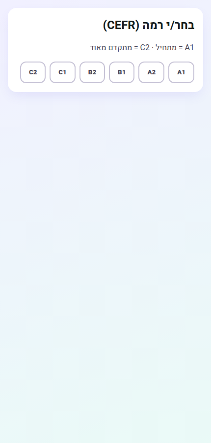
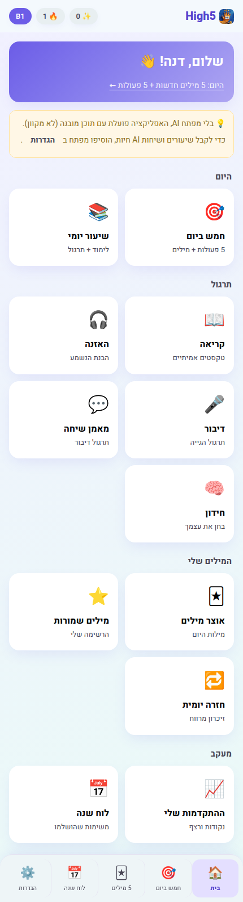
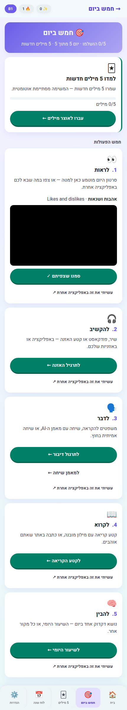
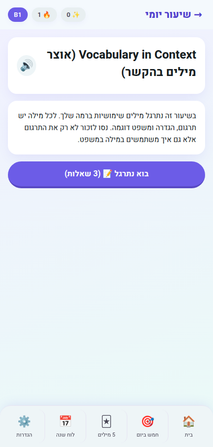
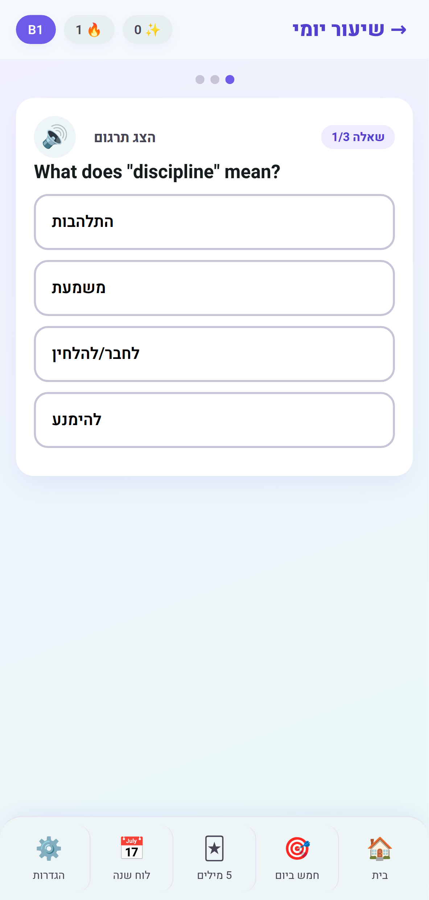
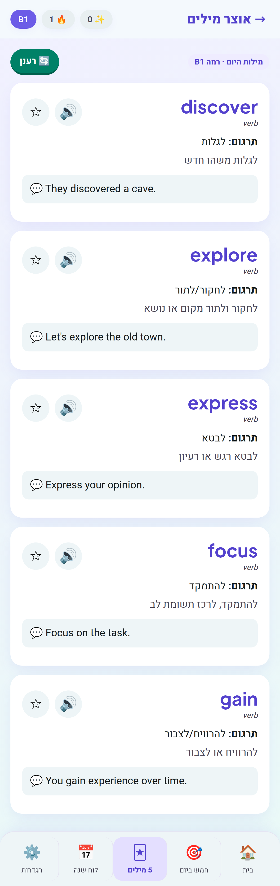
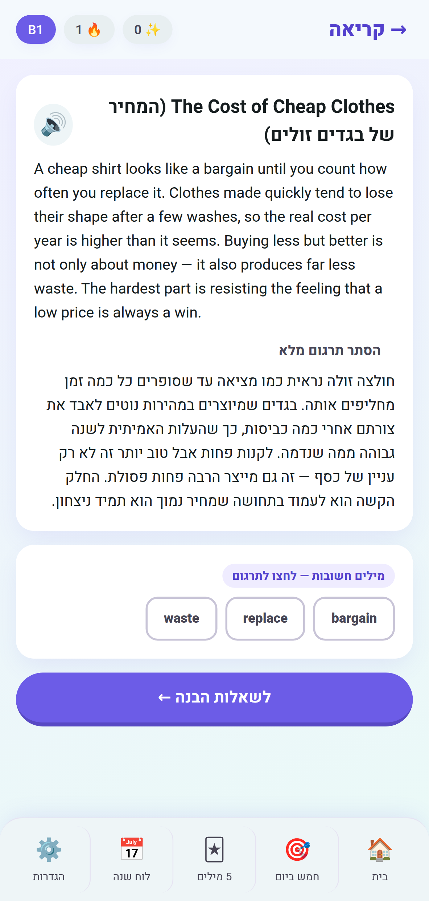
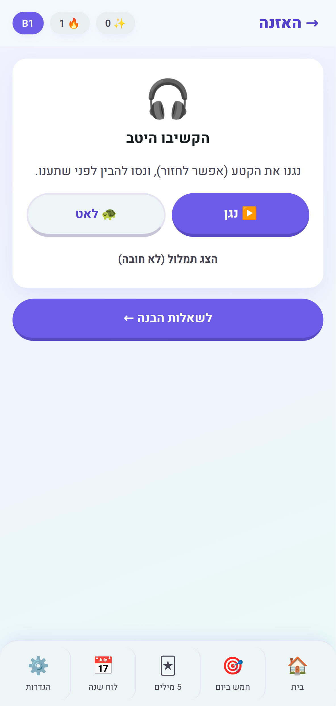
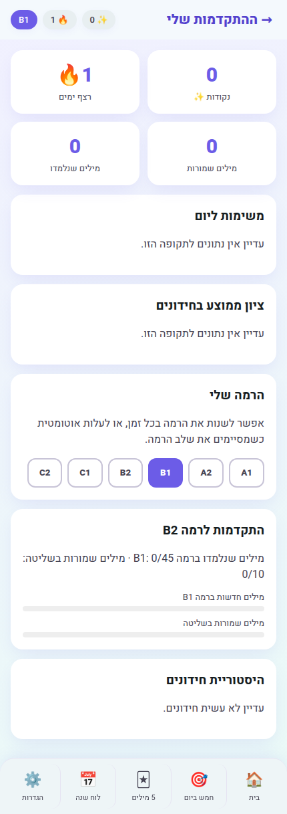
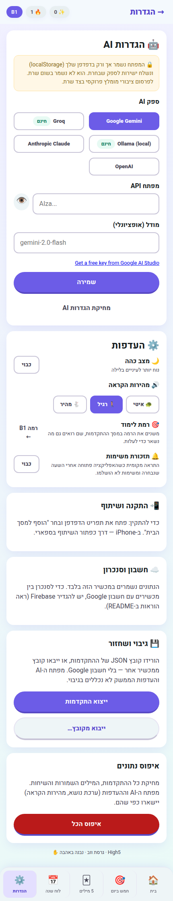

# High5 ✋

A playful **English-learning web app for Hebrew speakers** — daily lessons,
vocabulary flashcards, quizzes, and an AI Dialogue Coach. Built with React +
Vite + TypeScript.

It works out of the box with bundled offline content (CEFR levels A1–C2). A
service worker precaches the app shell so a cold start still boots offline once
you've visited online; per-level content chunks cache the first time you open
that level. Add a provider key for AI-generated lessons/vocab/quizzes and live
Dialogue Coach conversations.

## Screenshots

All screenshots below are the app's Hebrew RTL UI. After picking (or testing
into) a CEFR level, everything below is one tap away from the home hub.

**Onboarding** — pick your level yourself, or take a short placement test:



**Home hub** — today's mission, and every practice mode, word list, and
progress view grouped by intent:



**חמש ביום (Five a day)** — the daily board: five operations (see, listen,
talk, read, understand), each completable in-app or marked done from
elsewhere, plus the day's five new words:



**Daily lesson → practice quiz** — a short grammar explanation, then a
multiple-choice check with Hebrew explanations:

| Daily lesson | Practice quiz |
| --- | --- |
|  |  |

**Vocabulary flashcards** — level-adaptive words with Hebrew definitions,
examples, and text-to-speech, one tap from being saved for spaced review:



**Reading Lab** — a level-adapted passage with a tap-to-translate glossary
(save a word straight into review) and a full-translation toggle:



**Listening practice** — a natural spoken clip, with a slow-replay option,
before comprehension questions:



**Progress** — points, streak, level-up requirements, and daily activity,
all in one place:



**Settings — AI provider.** No environment variables: pick a provider, paste
a key (or an Ollama URL), and every AI-backed feature switches on:



To regenerate these images locally:

```bash
npm run build && npm run preview -- --port 4173   # in another terminal
npx playwright test e2e/screenshots.spec.ts
```

## The daily rhythm — 5 words, 5 operations, 5-day cycle

High5 asks for the same small thing every day: **five new words** and **five
operations** on the language.

| Operation | In the app | Or anywhere else |
| --- | --- | --- |
| 👀 **See** (לראות) | the day's short video, embedded | any video/series — mark it done and name it |
| 🎧 **Listen** (להקשיב) | a listening clip + comprehension questions | a song or podcast — mark it done and name it |
| 🗣️ **Talk** (לדבר) | sentences to read aloud, or the AI Dialogue Coach | a conversation anywhere (including with an AI assistant) |
| 📖 **Read** (לקרוא) | a level-adapted passage with a tap-to-translate glossary | an article on any site |
| 🧠 **Understand** (להבין) | the daily grammar lesson | a grammar explanation from any source |

Anything done inside the app completes its mission automatically. Anything done
elsewhere is marked by hand — and the app asks **what** you watched, listened
to or read, so the calendar keeps the title (`האזנה באנגלית — Bohemian
Rhapsody`) and not just a checkmark. Each mission is worth 30 points.

Days run in a **five-day cycle**: days 1–4 add five new words each, and **day 5
is a Memorization day (שינון)** — no new words, just the cycle's 20 words back
as a self-test list and a mixed recall quiz (English→Hebrew and Hebrew→English).

## Features

- **Daily lesson** — a Hebrew explanation plus a 3-question practice quiz.
- **Vocabulary flashcards** — level-adaptive words with Hebrew definitions,
  examples, and text-to-speech pronunciation.
- **Spaced-repetition review** — saved words enter a Leitner review queue so
  they actually stick; self-grade each card and the app schedules the next review.
- **Reading Lab** — short, level-adapted passages ("live texts") with a
  tap-to-translate glossary (save words straight into review) and comprehension
  questions.
- **Listening practice** — hear a natural spoken clip (with a slow-replay
  option), answer comprehension questions, then reveal the transcript.
- **Speaking practice** — read sentences aloud and get a pronunciation accuracy
  score via the browser's speech recognition.
- **Dialogue Coach** — roleplay scenarios where the AI replies in English and
  corrects your mistakes in Hebrew. *(Requires an AI key.)*
- **חמש ביום (Five a day)** — the daily board described above: the five
  operations plus the day's words (or the Memorization round on day 5). Every
  mission can be completed in the app or in another app.
- **Memorization (שינון)** — the cycle's 20 words as a self-test list, then a
  mixed recall quiz in both directions.
- **Practice quiz** — 5 multiple-choice questions with Hebrew explanations.
- **Saved words** — bookmark words, mark them mastered, review later.
- **Progress** — points, daily streaks, 14-day activity charts, and a placement
  test during onboarding.
- **Export / import** — download a JSON backup of local progress (or restore one)
  from Settings, without needing Google sync.
- **Hebrew RTL, mobile-first UI** with hash deep links (`#/missions`, etc.).

> The Reading, Listening and Speaking pillars were added to move beyond
> tap-the-answer drills toward *real language use* — reading, listening to
> natural speech, and actually speaking. Reading and Listening use bundled
> offline content (level-adapted passages and clips). Speaking uses bundled
> prompts by default and can generate fresh practice sets when a provider key
> is set. Only the Dialogue Coach *requires* a key.

### Bundled content

`npm run content` (or `node scripts/generate-content.mjs`) expands the curated
banks in `scripts/content/` into a year of daily content per CEFR level, written
to `src/data/offline/`. Two kinds of content come out of it:

- **Progressive** (`a1.reading.json`, …) — built from the learner's five words
  of the day, so it is always inside their vocabulary. 365 items per level.
- **Curated** (`a1.reading.curated.json`, …) — hand-written passages, clips and
  sentence sets. The app prefers a curated item whenever it is within the
  learner's reach, and falls back to the progressive one otherwise. "Within
  reach" allows a few new words — that's what the tap-to-translate glossary is
  for — and widens with the CEFR level, since a curated item is written *for*
  its level and the tracked word bank increasingly undercounts what a C-level
  learner actually knows.

To add curated content, append a round to `scripts/content/` and register it in
the generator's `*_ROUNDS` arrays. A reading or listening item only reaches the
curated pool if it is **fully bilingual** — `textHe`/`transcriptHe` plus
`questionHe` on every question (see `passages-extra9.mjs` for the shape); the
generator filters out anything that isn't and fails the build on a malformed
item.

**Checking the content.** `npm run content:audit` writes
[`docs/CONTENT-AUDIT.md`](./docs/CONTENT-AUDIT.md): per level, how often words
and quiz questions repeat over the year, how the taught words compare with the
open CEFR-J and Octanove word lists (`scripts/content/cefr/`), passage
difficulty, words taught at two levels, and hand-written passages that never
ship for lack of Hebrew. CI fails if the report is out of date or a word entry
is incomplete. After changing content, run `npm run content`, then
`npm run content:audit`, and commit all three together.

## Getting started

```bash
npm install
npm run dev      # start the dev server
npm run build    # production build
npm run preview  # preview the production build
```

Then open the local URL Vite prints.

## AI provider (optional)

AI is configured **in-app** — no environment variables. Open **Settings (⚙️)**,
pick a provider, paste a key (or an Ollama URL), and Save. Your choice is stored
in your browser (`localStorage`).

| Provider | Notes | Get a key |
| --- | --- | --- |
| **Groq** | free tier, fast | <https://console.groq.com/keys> |
| **Google Gemini** | free tier | <https://aistudio.google.com/app/apikey> |
| **Anthropic Claude** | paid | <https://console.anthropic.com/settings/keys> |
| **OpenAI** | paid | <https://platform.openai.com/api-keys> |
| **Ollama** | local, no key | <https://ollama.ai> |

Without a key, lessons, vocabulary, and quizzes use the bundled offline content —
only the Dialogue Coach needs a provider.

## Sync across devices with Google Drive (optional)

By default your progress is saved **locally** in the browser. You can connect
your own **Google Drive** to sync it across devices. The data goes into Drive's
hidden *appDataFolder*, which only this app's OAuth client can read. The
browser talks to Google directly, so no High5 server (and nobody running one)
ever holds a copy of anyone's learning data.

How it works ([`src/services/driveSync.ts`](src/services/driveSync.ts), ported
from KanDOne):

- **One file per device.** Each device writes only its own
  `high5-<deviceId>.json` and reads everyone's. Drive has no conditional write,
  so two devices sharing one file would silently overwrite each other.
- **Merged per record.** Each record keeps its newest version; deletes are
  kept as tombstones so they don't come back. Profile fields (`progress`,
  `dailyMissions`) take the newest copy.
- **Unsynced changes survive.** A change that hasn't reached Drive yet is
  recorded as pending ([`src/utils/pendingSync.ts`](src/utils/pendingSync.ts))
  and replayed on the next connect instead of being overwritten.
- **Accounts stay separate.** Signing out clears the device. Local data that
  belongs to a different Google account is never merged into the one
  connecting.
- **Settings → "מחיקת הנתונים מ-Google Drive"** deletes every High5 file from
  your Drive and revokes the app's access.
- **Two open tabs on one device share one file.** A stale tab that pulls can
  overwrite a newer edit the other tab hasn't uploaded yet. This is the same
  trade-off KanDOne makes; reload the other tab after a burst of edits.

To turn it on, use a Google Cloud project (a Firebase project counts):

1. Enable the **Google Drive API**.
2. Under **Data Access**, add the scope
   `https://www.googleapis.com/auth/drive.appdata`. It is non-sensitive, so no
   verification is needed. Under **Audience**, click **Publish app**.
3. Create a **Web application** OAuth client. Under **Authorized JavaScript
   origins**, add the production URL (and any preview URL you test on).
4. Set `VITE_GOOGLE_CLIENT_ID` to the client ID, in `.env` locally (see
   [`.env.example`](./.env.example)) and in **Vercel → Settings → Environment
   Variables**, then redeploy.

Without it the app stays in Local mode. The client ID is a public identifier,
not a secret.

## Daily missions reminder (optional)

Any browser can opt into a push notification that fires at 18:00 local time
if the learner hasn't opened the app and hasn't finished today's missions.
Enable it from **Settings → 🔔 תזכורות יומיות**. No Google sign-in is needed.

**The server stores almost nothing.** Per browser install,
`reminders/{installId}` holds a push token, a timezone, and two dates the
browser reports: the last day it opened the app, and the last day it finished
every mission. There is no account, no progress, and no content. The browser
gets back a random write key, of which the server keeps only the SHA-256; every
update or opt-out must present the key. See
[`api/_lib/reminderApi.ts`](api/_lib/reminderApi.ts).

This has four parts:

1. **Web Push (client).** Set the Firebase web-app config
   (`VITE_FIREBASE_*`) and a VAPID key (Firebase console → **Project settings →
   Cloud Messaging → Web Push certificates**) as `VITE_FIREBASE_VAPID_KEY`,
   locally and in Vercel.
2. **Registration (`api/reminder-register.ts`, `api/reminder.ts`).**
   - Register checks the token with an FCM dry-run send.
   - Both endpoints accept only `application/json`, so another site can't call
     them through a visitor's browser.
3. **The check (`api/mission-reminder.ts`).** It needs two *server-only*
   Vercel environment variables (do not put these in `.env`/`VITE_*`):
   - `FIREBASE_SERVICE_ACCOUNT` — the full JSON of a service account key,
     pasted as a single-line string. All three functions use it.
   - `CRON_SECRET` — any random string; it authorizes calls to the check.
     Without it the check rejects every call (it fails closed).

   Installs are read in pages of 500 and sent with FCM `sendEach`. An install
   whose token FCM reports as dead is removed. Each run logs one aggregate
   line (`checked`/`sent`/`removed`/`failed`, no tokens or ids).
4. **The schedule (`.github/workflows/mission-reminder.yml`).** It calls the
   check every hour. Vercel's free Hobby plan only allows a once-a-day cron,
   which can't respect each learner's timezone, so the trigger lives in
   GitHub Actions and the check decides per install whether it's that
   learner's reminder hour. Add these repo secrets (**Settings → Secrets and
   variables → Actions**):
   - `REMINDER_ENDPOINT_URL` — `https://<your-vercel-domain>/api/mission-reminder`
   - `CRON_SECRET` — the same value set in Vercel

Deploy [`firestore.rules`](./firestore.rules) (deny everything to clients;
only the Admin SDK touches `reminders`).

**Upgrading from the Firestore version:**

- Learning data no longer goes to Firestore. The old `users/{uid}` documents
  are left in place and read by nothing. Delete the `users` collection from the
  Firebase console once every device has connected to Drive.
- Reminder opt-ins made before this change were stored under `users/{uid}`,
  which the check no longer reads. Those browsers stop getting reminders until
  they opt in again from Settings.

## Android app

The same app ships as an Android APK: the web build inside a Capacitor shell
([`capacitor.config.json`](capacitor.config.json), [`android/`](android/)).
On a phone, open Settings on the website and tap **🤖 הורדת אפליקציית
אנדרואיד**, or download
[the latest release](https://github.com/joka-7/HighFive/releases/latest/download/High5.apk).

What differs from the website:

- **Reminders need no server.** Settings → 🔔 תזכורת משימות schedules a
  notification at the chosen hour with Android itself, so it fires while the
  app is closed and skips days whose missions are done.
- **Google Drive sync** signs in through Android's own Google account sheet,
  since Google blocks its web sign-in inside apps.
- **Speech** uses the phone's text-to-speech and speech recognition.

[`.github/workflows/android.yml`](.github/workflows/android.yml) builds the
APK on every pull request, and signs and publishes it as a release on every
push to `main`. It needs a signing key, an Android OAuth client and three repo
secrets; [`docs/LLD.md`](docs/LLD.md#android-app) has the one-time setup.

## Testing

```bash
npm test            # unit + integration tests (Vitest + React Testing Library)
npm run test:coverage  # same + coverage floors on store/services/utils
npm run test:e2e    # end-to-end tests (Playwright: desktop + mobile)
npm run lint
npm run typecheck
```

CI runs lint, type-check, unit tests with coverage, a production-dependency
security audit, a shell-bundle size gate, the build, and Playwright E2E on every
push and pull request.

## Deploy (Vercel)

1. Import the repo at <https://vercel.com/new> — Vercel auto-detects Vite.
2. **Root Directory** must be the repo root (leave it empty).
3. Optional environment variables (see [`.env.example`](./.env.example)):
   - `VITE_GOOGLE_CLIENT_ID` — enable Google Drive sync
   - `VITE_FIREBASE_*` — enable web-push reminders
   - `VITE_SENTRY_DSN` — optional error monitoring (Sentry)
4. `vercel.json` applies hardened HTTP security headers automatically.

## Security

This is a client-side app: a key entered in the browser is stored in
`localStorage` and sent directly to your chosen provider. That's fine for
personal use. For a public deployment, proxy the AI calls through a backend and
keep the key server-side.

## Repo structure

<!-- BEGIN GENERATED TREE (depth=1 entries=all) -->
```text
HighFive/
├── .github/
├── android/               # Capacitor Android project wrapping the web build (see LLD, Android app)
├── api/                   # Vercel Serverless Functions — built independently of the Vite app,…
├── docs/
├── e2e/                   # Playwright end-to-end specs, run via `npm run test:e2e`
├── public/                # Static assets + PWA manifest/service worker, served as-is by Vite
├── scripts/               # Content generation (`npm run content` rebuilds src/data/offline/*.json), the…
├── src/                   # The Vite app: screens, components, state (useLingo), and content/offline…
├── .ai                    # Ogen-ai submodule — the shared source of rules, skills and the ai-sync…
├── .env.example
├── .gitignore
├── .gitleaksignore
├── .gitmodules
├── AGENTS.md              # The compiled coding rules every AI assistant reads — generated, do not…
├── CLAUDE.md              # Claude Code's copy of AGENTS.md (generated)
├── GEMINI.md              # Gemini CLI's copy of AGENTS.md (generated)
├── LICENSE
├── README.md              # High5 ✋
├── SECURITY.md            # Security Policy
├── ai-config.toml         # Which rule fragments and target tools ai-sync compiles for this repo
├── capacitor.config.json  # Capacitor app id, name and web build folder for the Android app
├── eslint.config.js
├── firestore.rules
├── index.html
├── package-lock.json
├── package.json
├── playwright.config.ts
├── stitch-prompt.md       # Google Stitch Prompt
├── tsconfig.api.json      # Strict type-check for api/ (Node), run by `npm run typecheck`
├── tsconfig.json
├── vercel.json
├── vite-env.d.ts
└── vite.config.ts
```
<!-- END GENERATED TREE -->

Full annotated tree: [`docs/STRUCTURE.md`](./docs/STRUCTURE.md).

## Design docs

- [`docs/HLD.md`](./docs/HLD.md) — architecture and data flow.
- [`docs/LLD.md`](./docs/LLD.md) — module-level design detail.
- [`docs/CONTENT-AUDIT.md`](./docs/CONTENT-AUDIT.md) — generated report on the learning content per level.

## License

MIT — see [LICENSE](./LICENSE).
